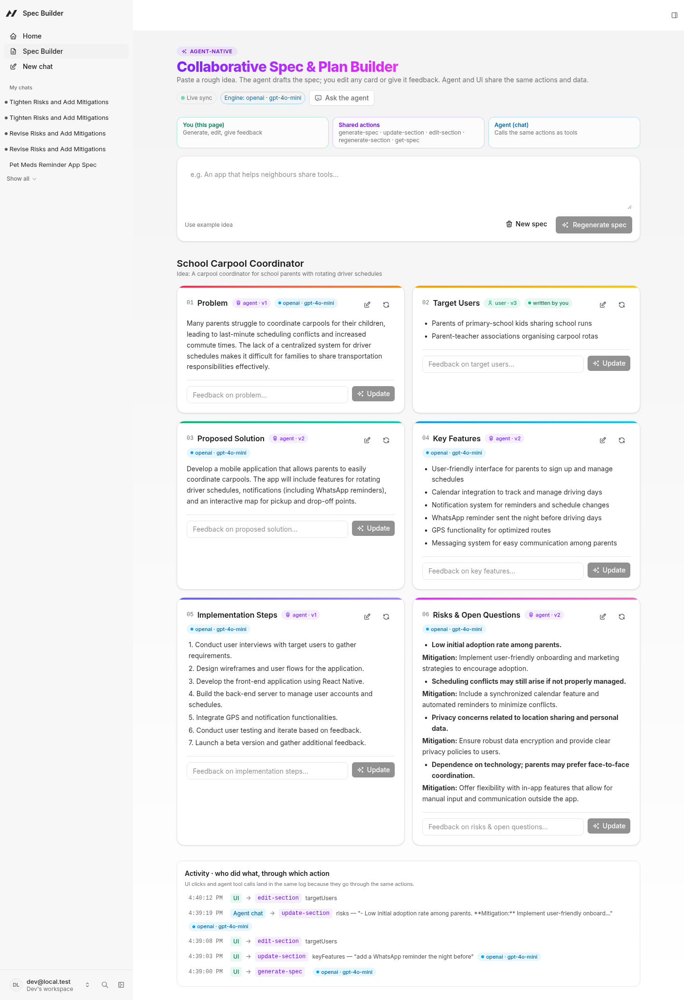

# Collaborative Spec & Plan Builder (spec-builder)

An **Agent-Native** app for the Builder.io Agent-Native Hackathon. You paste a rough product or feature idea, and an AI agent turns it into a structured spec with six editable sections:

**Problem · Target Users · Proposed Solution · Key Features · Implementation Steps · Risks & Open Questions**

You stay in control. You can edit any card inline, give feedback on one card (the agent rewrites only that section and, if needed, makes small fixes to related sections), regenerate a single card, or drive everything from the agent chat. The UI and the agent call **the same actions** on **the same data**, so every change shows up live on both sides, with an `agent` or `user` badge, a version number and an activity log.



## Run it

```bash
pnpm install          # if node-pty fails to compile: pnpm install --config.ignore-scripts=true
cp .env.example .env  # AUTH_DISABLED=true skips login for local demos
pnpm dev              # opens http://localhost:8080 → go to /spec ("Spec Builder" in the sidebar)
```

Other commands: `pnpm typecheck`, `pnpm build`, and `pnpm agent-native:doctor`.

### LLM keys (optional)
| Variable | Effect |
|---|---|
| `OPENAI_API_KEY` (+ `OPENAI_MODEL`, default `gpt-4o-mini`) | Spec actions use OpenAI with JSON output |
| `ANTHROPIC_API_KEY` (+ `ANTHROPIC_MODEL`) | Used if no OpenAI key is set |
| neither | A **deterministic offline mock** generator, so the demo always works |

The badge in the header shows the provider in use (for example `Live · mock (offline)`). If an LLM call fails, the actions fall back to the mock. The chat agent itself uses whatever model you configure in the app's agent settings.

## Architecture

```
actions/                    ← single source of truth (agent tools + UI hooks + HTTP + CLI)
  generate-spec.ts          idea → 6 sections (replaces current spec)
  update-section.ts         feedback → rewrite one section (+ optional related sections)
  edit-section.ts           direct inline edit (actor: user|agent)
  regenerate-section.ts     fresh draft of one section from the original idea
  get-spec.ts               read current spec (GET)
  new-spec.ts               clear current spec
  list-specs.ts             list / reopen earlier specs
server/lib/spec.ts          data model, persistence (framework settings store, SQL), LLM + mock
server/plugins/agent-chat.ts  agent system prompt + spec tools loaded on the first turn
app/routes/spec.tsx         UI: idea input, 6 editable cards, per-card feedback, activity log
```

- **Shared actions:** each `defineAction` is exposed as an agent tool, as `POST/GET /_agent-native/actions/<name>`, to the React page via `useActionQuery`/`useActionMutation`, and to the CLI (`pnpm action get-spec`).
- **Shared state:** the spec is saved in the framework's SQL-backed settings store (`spec-builder:current`, plus an archive per spec), so the agent, the UI and the CLI read and write the same record.
- **Live updates:** mutating actions refresh action queries automatically, the chat run stream invalidates queries after each agent tool call, and the page also polls `get-spec` every 2 s so changes made from the CLI or HTTP appear too. Changed cards briefly glow.
- **User control:** agent edits are attributed and versioned, user edits win (the agent is told to call `get-spec` first and never overwrite edits it wasn't asked to change), and every agent action is something the user can also do with a button.


**Source labels:** keys are read from the process environment or from `.env`. Every card shows its real source: `openai · gpt-4o-mini`, `offline mock`, `offline mock (LLM unavailable)` or `written by you`. The header warns when the configured LLM is failing (for example an exhausted quota).

### Chat agent on OpenAI
The in-app chat agent uses the framework engine `ai-sdk:openai`, which reads the same `OPENAI_API_KEY`. Start with `AGENT_ENGINE=ai-sdk:openai pnpm dev`, or set it via Settings → Model or the `manage-agent-engine` action (`{"action":"set","engine":"ai-sdk:openai","model":"gpt-4o-mini"}`). Then ask in chat: "Tighten the Risks section."

**Visible collaboration:** every action records `via` (`ui` or `agent`), and the activity log shows lines like `UI → edit-section` and `Agent chat → update-section`.

See **HACKATHON.md** for the rules checklist, disclosure, submission text and demo script.

## 2-minute demo script

1. **(0:00) Intro.** "Rough ideas become structured specs, with an agent and a human editing the same document."
2. **(0:15) Generate.** Open `/spec`, click *Use example idea*, then **Generate spec**. Six cards appear, each tagged `agent · v1`.
3. **(0:40) Targeted feedback.** On *Key Features* type "add in-app chat between borrower and lender" and click **Update**. Key Features *and* Implementation Steps glow, because the agent kept the related section consistent, and the toast says which sections changed.
4. **(1:05) Direct control.** Click ✏️ on *Problem*, edit the text, then **Save**. The badge turns `user · v2`, and the activity log shows `user edited`.
5. **(1:25) Agent from chat.** Click **Ask the agent** (or open the side chat) and say: "Tighten the risks section and add a pricing open question." Watch the *Risks* card update live while the chat explains what changed.
6. **(1:50) Close.** "One set of actions and one data model, so the agent and the UI are equal collaborators, and the human always has the last word."

## Limitations
- There's one shared "current spec" per app database, which suits a single-user demo. It isn't yet scoped per user or org.
- The offline mock is template-based. Use a real key for high-quality specs.
- Production keys should go through `resolveCredential` instead of `.env` (see the comment in `server/lib/spec.ts`).
