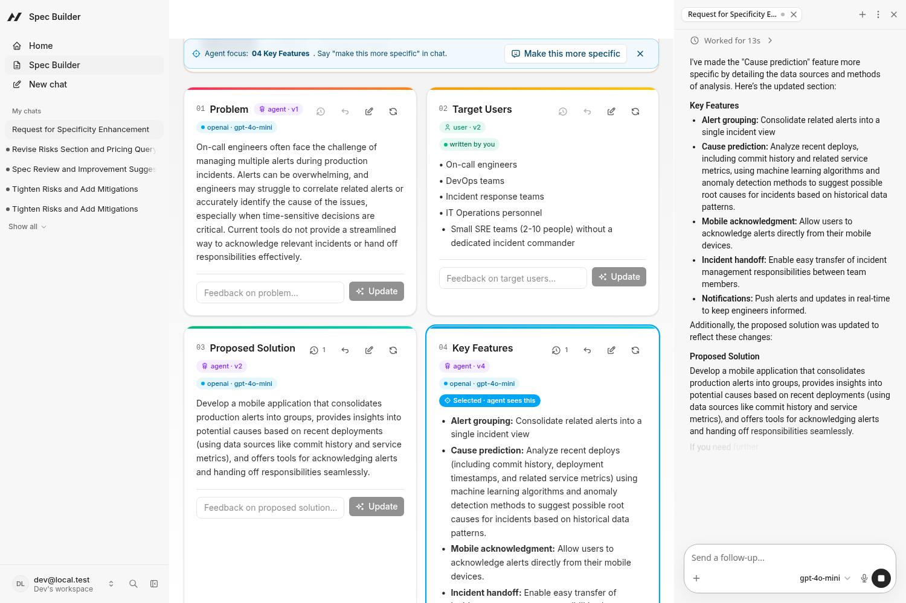
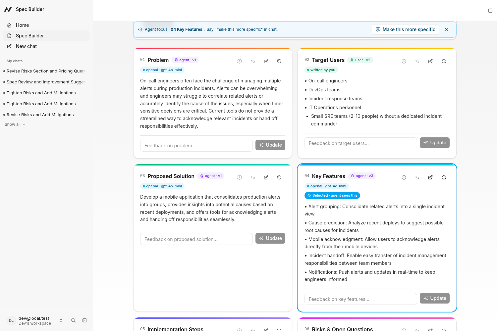
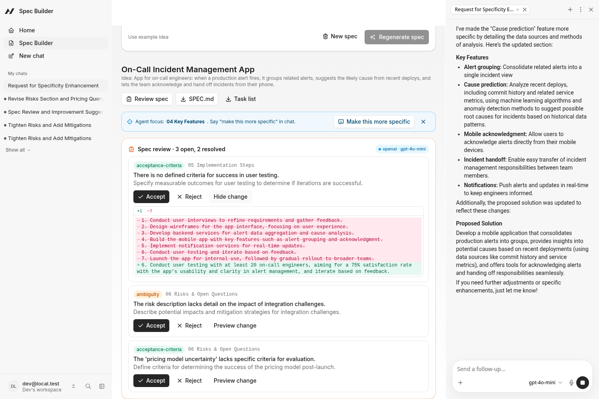
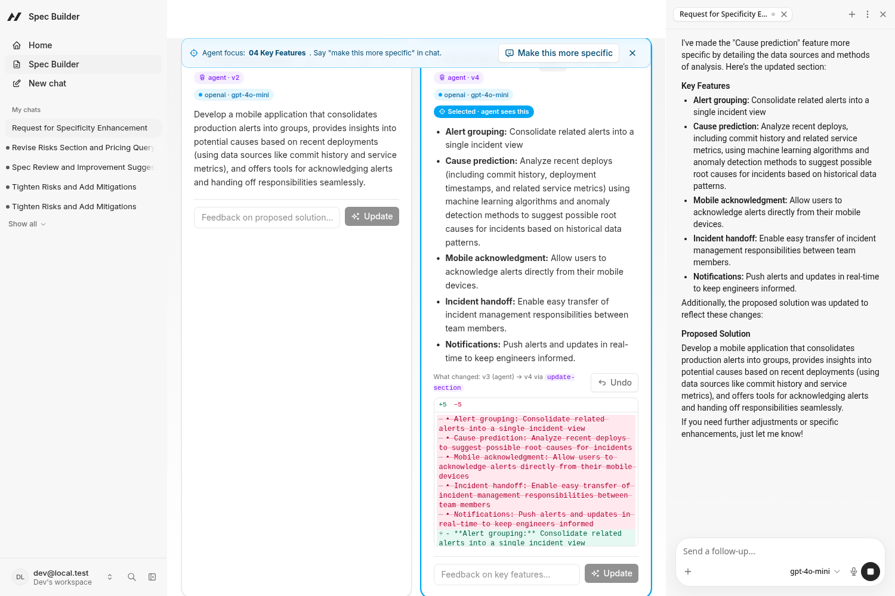
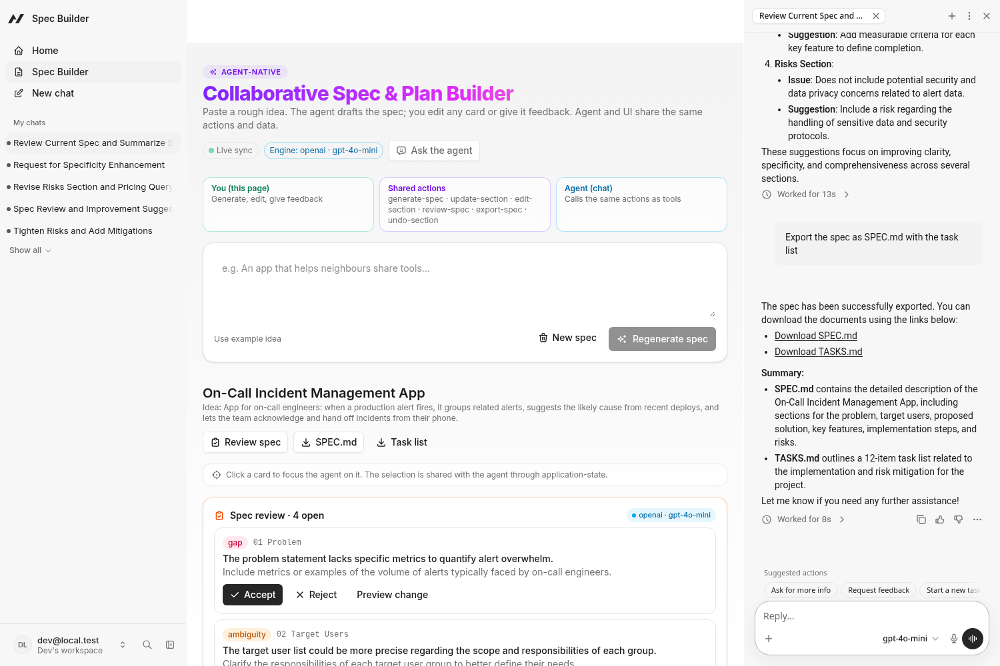
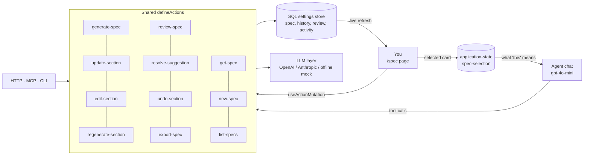

# Collaborative Spec & Plan Builder (spec-builder)

> **Turn a rough idea into a structured, reviewable spec that you and an AI agent build together: same data, same actions, and the human always has the last word.**

Built with the [Agent-Native](https://www.agent-native.com/docs/) framework for the Builder.io Agent-Native Hackathon.

🎬 **Demo video:** _[Clips link, added at submission]_ · local copy: [`docs/demo.mp4`](docs/demo.mp4) (2:22)



## Why

Specs start as a messy idea in someone's notes. Chat assistants can draft one, but the result lives in a chat transcript you can't edit, review or trust. Spec Builder puts the spec in a real UI. The agent and the human edit the **same document through the same actions**, and every change is attributed, versioned and undoable.

## Features

| | Feature | What it does |
|---|---|---|
| ✨ | **Idea → spec** | One click turns an idea into six cards: Problem · Target Users · Proposed Solution · Key Features · Implementation Steps · Risks & Open Questions |
| ✏️ | **Edit, feedback, regenerate** | Edit any card inline, give feedback on one card (the agent rewrites it and keeps related cards consistent), or regenerate a single card |
| 🎯 | **Selected-card awareness** *(new)* | Click a card: the selection is written to application-state, so "make this more specific" in chat just works without naming the card |
| 🧐 | **Spec review with Accept / Reject** *(new)* | The agent returns typed suggestions (gap, ambiguity, acceptance criteria). Preview the exact diff, then Accept or Reject each one |
| 🕘 | **Per-card history, diff and Undo** *(new)* | Each card keeps its last 10 versions, shows a red/green diff of what changed and who changed it, and restores in one click |
| 📄 | **Export SPEC.md + task list** *(new)* | Download SPEC.md and a TASKS.md checklist from a button or by asking the agent in chat |
| 🏷️ | **Honest provenance** | Every card shows `agent`/`user`, its version and its real source (`openai · gpt-4o-mini`, `offline mock` or `written by you`) |
| 📜 | **Activity log** | Every step shows as `UI → action` or `Agent chat → action` |

| Selection | Review | Diff & Undo | Export from chat |
|---|---|---|---|
|  |  |  |  |

## How it uses Agent-Native

- **Actions are the single source of truth.** Every capability is one `defineAction` in `actions/`. The same action is an agent tool, a React hook (`useActionQuery` / `useActionMutation`), an HTTP endpoint (`/_agent-native/actions/<name>`), an MCP tool and a CLI command (`pnpm action get-spec`).
- **Application-state lets the agent see the UI.** The `/spec` page writes the selected card to application-state (`spec-selection`, tab-scoped). `get-spec`, `view-screen` and the section actions read it, so "this" resolves to what you're looking at.
- **Shared data, live sync.** The UI and the agent read and write the same SQL-backed spec record. Agent tool calls invalidate the page's queries, so cards update and glow live while the agent works.
- **The human stays in control.** The agent proposes (review suggestions) and the human decides. Every edit is versioned and undoable, and the agent is told never to overwrite user edits it wasn't asked to change.

## Architecture



```
actions/                      single source of truth (agent tools + UI hooks + HTTP + MCP + CLI)
  generate-spec.ts            idea → 6 sections
  update-section.ts           feedback → rewrite one section (+ related sections)
  edit-section.ts             direct inline edit (actor: user | agent)
  regenerate-section.ts       fresh draft of one section
  review-spec.ts              typed review suggestions with proposed content
  resolve-suggestion.ts       accept / reject a suggestion
  undo-section.ts             restore the previous version of a card
  export-spec.ts              SPEC.md + TASKS.md
  get-spec.ts · new-spec.ts · list-specs.ts
server/lib/spec.ts            data model, history, persistence, LLM + mock
server/plugins/agent-chat.ts  agent system prompt + first-turn tools
app/routes/spec.tsx           UI: cards, selection, review panel, diff, export, activity log
```

## Setup and run

Requires Node.js 20+ and pnpm.

```bash
pnpm install          # if node-pty fails to compile: pnpm install --config.ignore-scripts=true
cp .env.example .env  # then add your key; AUTH_DISABLED=true skips login for local demos
AGENT_ENGINE=ai-sdk:openai pnpm dev   # http://localhost:8080 → "Spec Builder" (/spec)
```

Checks: `pnpm typecheck`, `pnpm test`, `pnpm build`, `pnpm agent-native:doctor`.

The chat agent's model can also be set in Settings → Model. Then try: click a card → "Make this more specific", or "Export the spec as SPEC.md with the task list".

### Environment variables (names only)

| Variable | Purpose |
|---|---|
| `OPENAI_API_KEY` | Spec actions and the chat agent use OpenAI |
| `OPENAI_MODEL` | Optional, default `gpt-4o-mini` |
| `ANTHROPIC_API_KEY`, `ANTHROPIC_MODEL` | Used if no OpenAI key is set |
| `AGENT_ENGINE` | Chat engine, e.g. `ai-sdk:openai` |
| `AUTH_DISABLED` | `true` for local demos only |
| `DATABASE_URL`, `BETTER_AUTH_SECRET` | Production deployments only (local dev uses embedded PGlite) |

With no LLM key, a deterministic **offline mock** keeps the app usable, and every card is labelled `offline mock`.

## Limitations

- One shared "current spec" per database (fine for a single-user demo; not yet scoped per user or org).
- The offline mock is template-based; use a real key for good specs.
- Production keys should go through `resolveCredential` instead of `.env`.

See **[HACKATHON.md](HACKATHON.md)** for the rules checklist, pre-existing-work disclosure, demo script and submission text.

## Licence

[MIT](LICENSE). Built on the Agent-Native `chat` starter template and open-source libraries under their own licences.
